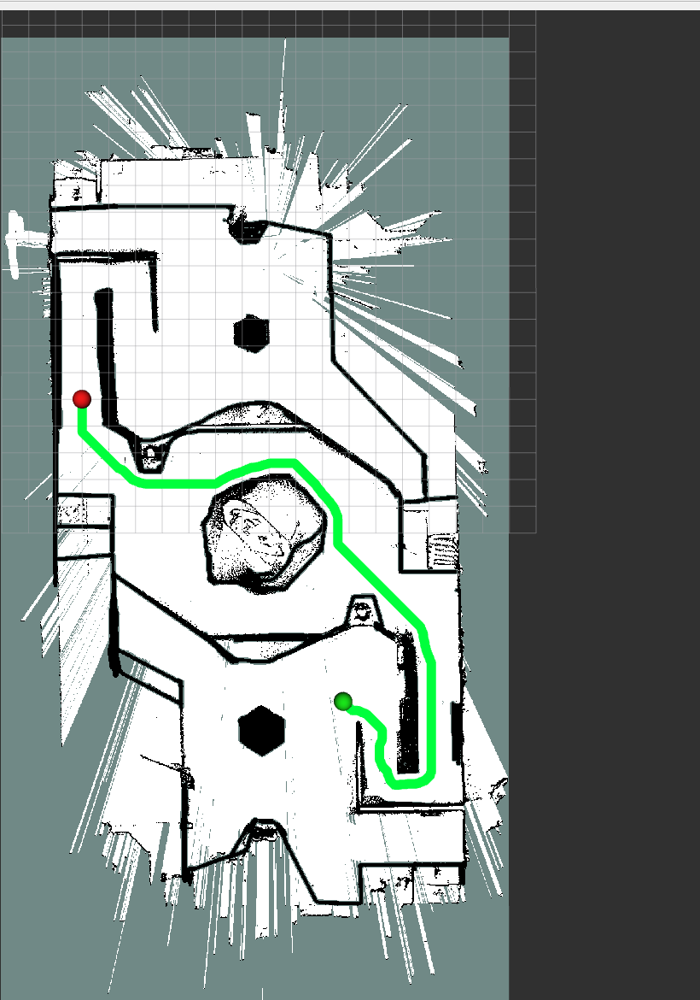
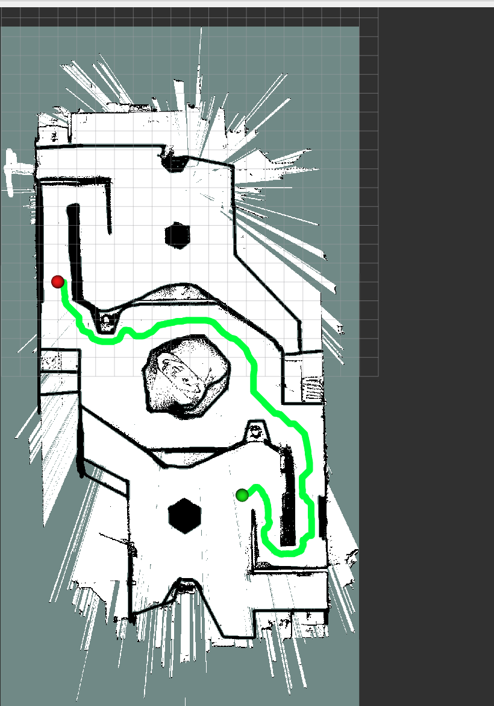

# two_point_planner —— RViz 地图两点最短路径（C++ / JPS / A*，含机器人本体膨胀）

在 ROS 2 + RViz 中加载 `mymap.pgm/mymap.yaml` 占据栅格地图（costmap），
用鼠标点击两个点，自动计算两点间最短路径并可视化。
内置 **机体膨胀代价模型**（参考 RoboMaster 比例）与 **JPS 跳点搜索**（可选 A*）。
核心节点为 **C++（rclcpp）** 实现，单次规划在毫秒级。



> 上图：绿色球 = 起点（2D Pose Estimate），红色球 = 终点（2D Nav Goal），
> 亮绿色带状线 = JPS 规划结果。机体半径按 RM 比例取 0.38 m，
> 路径绕障时与墙保持一圈余量（不是在墙角"擦着走"）。

两种规划器效果对比（同一对起终点）：

| JPS（默认，均匀代价） | A*（带代价衰减层） |
|---|---|
|  |  |
| 29.81 m / **≈16 ms** | 33.73 m / **≈45 ms** |
| 贴致死圈外侧，路径最短 | 走走廊中线，离墙更远但绕路 |

## 1. 效果

- RViz 中显示 `mymap` 占据栅格地图；
- 工具栏点 **「2D Pose Estimate」** → 在地图上点 **起点**（绿色球标记）；
- 工具栏点 **「2D Nav Goal」** → 在地图上点 **终点**（红色球标记）；
- 立刻看到一条 **亮绿色路径**（`/planned_path`），且与障碍保持机体半径以上距离；
- 重复点击任意一个点都会 **重新规划**。

## 2. 工作原理（数据流）

```
mymap.pgm + mymap.yaml
      │  nav2_map_server 加载并发布
      ▼
    /map (nav_msgs/OccupancyGrid, transient_local) ──┐
                                                     │   ┌──────────────────────────┐
 RViz「2D Pose Estimate」→ /initialpose ────────────┤   │ astar_planner 节点        │
                          (geometry_msgs/            ├──▶│  ① chamfer 距离变换      │
                           PoseWithCovarianceStamped)│   │  ② 致死层 + 衰减层       │
                                                     │   │  ③ JPS / A* 搜索         │
 RViz「2D Nav Goal」→ /goal_pose ────────────────────┘   └──────────┬───────────────┘
                          (geometry_msgs/PoseStamped)              │
                                        /planned_path (nav_msgs/Path) + /start_goal_markers
```

- **地图服务器** `nav2_map_server` 是 *生命周期节点*，必须由
  `nav2_lifecycle_manager` 激活后才会发布 `/map`；
- **地图 QoS** 是 `transient_local`（latched），所以订阅方（本节点、RViz Map 显示）
  的 Durability 必须设成 **Transient Local**，否则收不到地图；
- `/planned_path` 与 `/start_goal_markers` 也以 **Transient Local** 发布
  （深度 1），这样 RViz 后启动也能立刻看到最近一次结果；
  对应的 RViz 显示必须同为 Transient Local，否则会报
  `incompatible QoS ... DURABILITY_QOS_POLICY` 而收不到消息；
- 栅格值约定：`0` = 空闲，`100` = 占据（障碍），`-1` = 未知。

## 3. 机器人本体膨胀（参考 RoboMaster 比例）

RoboMaster 标准机器人约 **600 × 600 mm**，场地约 **28 × 15 m**；
本地图 **36.18 × 19.02 m**（1809×951 × 0.02 m），比例约 1.25 倍，
因此等效机体半径 ≈ `0.6 × 1.25 / 2 ≈ 0.38 m`（参数 `robot_radius`）。

节点收图后先做一次 **chamfer(3-4) 双扫描距离变换**，得到每格到最近墙体的
距离 `d`（米），再按 nav2 costmap inflation 层的思路分两层：

```
障碍 |<-- robot_radius -->|<------- inflation_radius -------->|
墙体 |      致死区         |        代价指数衰减区              | 自由区
     |  本体必撞，禁行     |  代价 *= 1 + w·e^(-k(d-r))        | 无惩罚
```

C++ 版对 1809×951（172 万格）做两遍扫描只需 **≈31 ms**（Python 版约 1.4 s），
且只在收到地图时执行一次。

| 层 | 判据 | 作用 |
|---|---|---|
| 致死层 | `d ≤ robot_radius` | 机器人中心不可能到达 → 路径天然离墙 ≥ 机体半径 |
| 衰减层 | `robot_radius < d < inflation_radius` | 越贴墙越贵 → 路径倾向走廊中线（仅 A* 模式参与寻优） |

其中 `k = cost_scaling_factor`（默认 3.0）、`w = penalty_weight`（默认 10.0）。

**未知区策略**：默认严格模式（未知 = 不可通行）。SLAM 地图里门槛、玻璃常被标成
灰色未知，RM 级半径下容易误判"不连通"，所以搜索失败时会 **自动放宽一次**
（允许穿越未知区）并打印告警，路径仍与真实墙体保持机体半径。参数
`allow_unknown:=true` 可一开始就允许穿越未知区。

## 4. 两种规划器：JPS 与 A*

### 4.1 JPS 跳点搜索（默认，推荐）

A* 在空白走廊里会一格一格地"铺"满 open 集，绝大多数扩展是无效的。
JPS 利用栅格图的 **对称性** 只扩展"跳点"：

- **跳跃（jump）**：沿某方向一直前进，中间点直接跳过；
- **强迫邻居（forced neighbor）**：前进方向上某侧被挡、而斜前方反而可走时，
  这个点必须入队（因为绕过障碍的转折就发生在这里）；
- **对角跳跃**：先沿两个正交分量各跳一次，任一分量撞到跳点，当前点也算跳点。

结果：扩展节点数通常比 A* 少 1~2 个数量级，且 **均匀代价下仍保证最短**。
代价是 JPS 不支持加权代价，所以衰减层只在 A* 模式生效。

### 4.2 A*（带衰减层）

对每个栅格 `n` 维护：

| 记号 | 含义 | 本实现 |
|------|------|--------|
| `g(n)` | 起点 → n 的实际累计代价 | 直走 +1，斜走 +√2，再乘 `(1+惩罚)` |
| `h(n)` | n → 终点的启发式估计 | octile 距离（八连通下的精确下界） |
| `f(n)` | 排序依据 `g+h` | 优先队列（最小堆） |

八邻域扩展，斜走时检查两个正交邻居，**禁止切角穿墙**。
`h` 不高估 → 保证（加权意义下）最优；衰减层让路径更愿意走中线，代价是变长。

### 4.3 实测对比（同一对起终点，1809×951 栅格）

| 规划器 | 路径长度 | C++ 单次规划 | 早期 Python 版 | 特点 |
|---|---|---|---|---|
| `jps` | 29.81 m | **≈ 6~20 ms** | ≈ 720 ms | 最快，贴致死圈外侧走 |
| `astar` | 33.73 m | **≈ 36~50 ms** | ≈ 1670 ms | 走走廊中线，离墙更远 |

距离变换（建代价层）耗时：C++ **31 ms** vs Python 1400 ms。

> 两者都满足"离墙 ≥ 0.38 m"的硬约束，区别只在"愿意为远离墙多绕多少路"。
> JPS 的耗时波动来自首次规划的缓存预热与虚拟机 CPU 调度，稳态在 10 ms 以内。

## 5. 在 VS Code 中开发

两种方式都行，推荐**直接用虚拟机里的 VS Code**（省掉远程连接，编译运行都在本地）。

### 5.1 方式一：虚拟机内直接开（推荐）

```bash
# 虚拟机终端
sudo snap install code --classic        # 若未安装
code --install-extension ms-python.python
code --install-extension ms-iot.vscode-ros
code ~/two_point_planner_ws
```

### 5.2 方式二：Windows 侧 VS Code 远程连接（Remote-SSH）

1. 虚拟机先开启 SSH：
   ```bash
   sudo apt update && sudo apt install -y openssh-server
   sudo systemctl enable --now ssh
   ip addr show     # 确认 IP，例如 192.168.207.128
   ```
2. Windows 侧 VS Code 安装扩展 **Remote - SSH**；
3. `Ctrl+Shift+P` → `Remote-SSH: Connect to Host` → 输入 `ian@192.168.207.128`；
4. `File → Open Folder` → `/home/ian/two_point_planner_ws`；
5. 内置终端里执行下面的编译运行命令，命令实际跑在虚拟机中。

> 建议在 `~/.ssh/config` 里加一条别名，之后直接 `Connect to Host: ubuntu-vm`：
> ```
> Host ubuntu-vm
>     HostName 192.168.207.128
>     User ian
> ```

### 5.3 编译（C++）

```bash
cd ~/two_point_planner_ws
source /opt/ros/humble/setup.bash        # 按实际 ROS 发行版替换 humble
rosdep install --from-paths src -y --ignore-src   # 首次：装依赖
colcon build                             # C++ 包，改代码后需重新编译
source install/setup.bash
```

> 需要 `build-essential`、`cmake`（ROS 桌面版通常已带）：
> `sudo apt install -y build-essential cmake`。
> 想改一行就生效可以加 `--symlink-install`，但 C++ 仍需重新编译——几千行规模十几秒就好。

### 5.4 运行

```bash
ros2 launch two_point_planner path_planning.launch.py
```

启动后 RViz 出现在 **虚拟机桌面** 中（RViz 是 GUI 程序，画面在虚拟机里操作）。

可选参数：

```bash
# 换一张地图
ros2 launch two_point_planner path_planning.launch.py map_yaml:=/path/to/other.yaml
# 换成 A*（带代价衰减层，走走廊中线）
ros2 launch two_point_planner path_planning.launch.py planner:=astar
# 机体半径调大/调小（米）；调大后更保守，但窄门可能过不去
ros2 launch two_point_planner path_planning.launch.py robot_radius:=0.30
# 衰减层外边界（米），只影响 astar 模式
ros2 launch two_point_planner path_planning.launch.py inflation:=0.80
# 不启动 RViz（无桌面调试时）
ros2 launch two_point_planner path_planning.launch.py use_rviz:=false
```

### 5.5 操作顺序

1. 等待终端打印 `代价层构建完成 ...` 与 `两点规划器已启动`；
2. RViz 工具栏点 **2D Pose Estimate** → 在地图空白处点一下（起点）；
3. RViz 工具栏点 **2D Nav Goal** → 再点一下（终点）；
4. 绿色路径出现，终端打印
   `[JPS] 规划成功：N 个路径点，长度约 X.XX 米，耗时 Y ms`。

## 6. 包结构

```
two_point_planner_ws/
├── docs/                           # README 配图
└── src/two_point_planner/
    ├── package.xml                 # ament_cmake 依赖声明
    ├── CMakeLists.txt              # C++ 构建（可执行文件 astar_planner）
    ├── maps/
    │   ├── mymap.pgm               # 占据栅格位图
    │   └── mymap.yaml              # 分辨率/原点/阈值等元数据
    ├── launch/
    │   └── path_planning.launch.py # 一键启动：map_server+lifecycle+planner+rviz
    ├── rviz/
    │   └── astar.rviz              # 预置 RViz 配置（Map/Path/MarkerArray 显示）
    └── src/
        └── astar_planner_node.cpp  # ★ 核心：代价层 + JPS/A*（详细中文注释）
```

## 7. 可调参数

| 参数 | 默认 | 说明 |
|------|------|------|
| `planner` | `jps` | 规划器：`jps`（快）或 `astar`（走中线） |
| `robot_radius` | 0.38 | 机器人等效半径（米），距墙小于此值即不可通行 |
| `inflation_radius` | 1.20 | 衰减层外边界（米），仅 astar 模式参与寻优 |
| `cost_scaling_factor` | 3.0 | 衰减指数 k，越大越"贴墙惩罚陡" |
| `penalty_weight` | 10.0 | 贴墙惩罚权重 w |
| `occupied_thresh` | 65 | 栅格值 ≥ 此值视为障碍 |
| `allow_unknown` | false | 未知区是否可通行（false 时找不到路会自动兜底一次） |

## 8. 关于「RViz 的 costmap 插件」

RViz2 里并没有叫 “costmap” 的独立插件，实际做法是：

- **Map 显示**（`rviz_default_plugins/Map`）渲染 `nav_msgs/OccupancyGrid`，
  这正是 costmap 的数据结构 —— nav2 的 `global_costmap` 也最终以 `OccupancyGrid` 形式发布；
- costmap 的「膨胀层」在本包里由 `robot_radius`（致死层）+
  `inflation_radius`/`cost_scaling_factor`（衰减层）实现，语义与 nav2 一致。

如需接入完整的 nav2 代价地图（多层 costmap + Smac/Global Planner），
可把 `nav2_costmap_2d` 的 `Costmap2DROS` 作为上游，把本节点的输入从 `/map`
换成 `/global_costmap/costmap`，代价层构建逻辑可以整段删掉（nav2 已代劳），
JPS/A* 代码无需改动。

## 9. 常见问题（FAQ）

1. **RViz 中 Map 显示 "No Map Received"**
   → Map 显示属性的 Topic Durability 没设成 *Transient Local*
   （本包 rviz 配置已设好；自己新建 Map 显示时注意）。

2. **点了点没反应 / 提示"位于机体膨胀致死区"**
   → 点太靠近墙了，换个离墙 > `robot_radius` 的位置。

3. **提示"严格模式未找到路径，自动放宽…"**
   → 地图里有灰色未知区把通道封住了（常见于门槛），已自动兜底；
   想彻底避免可把这部分补成白色自由区，或 `allow_unknown:=true`。

4. **`ros2 launch` 找不到包**
   → 忘记 `source install/setup.bash`，或没在 `~/two_point_planner_ws` 下编译。

5. **没有 RViz 界面**
   → RViz 画面显示在虚拟机桌面里，不在 Windows 侧；
   确认虚拟机桌面处于登录状态。

6. **想更保守 / 更激进**
   → `robot_radius:=0.45` 更保守（可能过不去窄门）；
   `robot_radius:=0.25` 更灵活，适合小尺寸底盘。

7. **规划太慢**
   → 保持 `planner:=jps`（毫秒级）；`astar` 带衰减层遍历更多节点，约几十毫秒，
   在 20 Hz 以上重规划场景也不构成瓶颈。

8. **RViz 里看不到绿色路径 / 红绿球**
   → 两个常见原因：
   ① `/planned_path`、`/start_goal_markers` 是 Transient Local 发布，
   RViz 显示项的 Durability 也要设成 Transient Local（本包配置已设好）；
   ② 起终点标记是 `MarkerArray`，RViz 显示类必须选
   **`rviz_default_plugins/MarkerArray`**（选成单个 `Marker` 会一直收不到）。

9. **路径线太细 / 太粗**
   → Path 显示的 `Line Style` 用 **Billboards** 才会按米加宽
   （`Lines` 样式用的是 OpenGL 固定 1px，改 `Line Width` 无效）。
